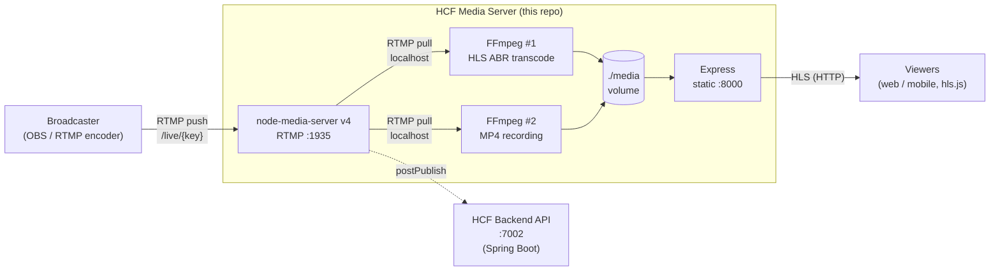
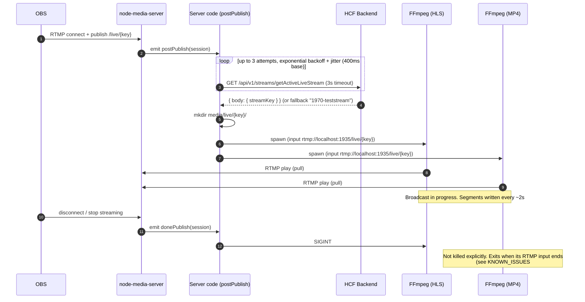

# Architecture

This document describes how the HCF Media Server works **as the code stands today** (`hcf-media-svr-test.js`).
Proposed changes are tracked as [ADRs](adr/README.md) and [known issues](KNOWN_ISSUES.md).

## 1. Context: where this service sits

The media server is one service in the HCF platform. It owns **live video ingest, transcoding and delivery**.
Everything else (users, schedules, which stream is live, the website) belongs to the HCF backend and frontend.



| Component | Technology | Responsibility |
|---|---|---|
| RTMP ingest | `node-media-server` 4.2.8 | Accept the encoder's RTMP push; re-serve it to local FFmpeg; emit lifecycle events |
| HLS transcoder | FFmpeg (`libx264` + `aac`) | Split into 4 renditions, segment into fMP4 HLS |
| Recorder | FFmpeg (video copy, `aac` audio) | Write a fragmented MP4 of the whole broadcast |
| File server | Express 5 + `cors` | Serve `./media` as static files on port 8000 |
| Stream key lookup | `axios` → HCF backend | `GET /api/v1/streams/getActiveLiveStream` → `body.streamKey` |

## 2. Stream lifecycle



Key points:

- **FFmpeg pulls from the server itself** (`rtmp://localhost:1935/...`), so node-media-server acts as a local fan-out
  hub. That's why the two FFmpeg processes are independent and a crash in one does not affect the other.
- **The stream key comes from the backend API**, not from the RTMP URL OBS used.
  This is a side effect of how the v4 event API is used today; see [§5](#5-node-media-server-v4-notes) and
  [KNOWN_ISSUES #2](KNOWN_ISSUES.md#2-event-handlers-use-the-v2-signature).
- If the API is unreachable after 3 attempts, the server uses the fallback key **`1970-teststream`**.

## 3. Output layout

For a stream key `2026-10-18M-sunday-school`, the `./media` volume contains:

```
media/
└── live/
    └── 2026-10-18M-sunday-school/
        ├── index.m3u8                      ← master playlist (give this URL to players)
        ├── v540p/  stream.m3u8, init_0.mp4, stream0.m4s, stream1.m4s, …
        ├── v480p/  stream.m3u8, init_1.mp4, stream*.m4s
        ├── v360p/  stream.m3u8, init_2.mp4, stream*.m4s
        ├── v144p/  stream.m3u8, init_3.mp4, stream*.m4s
        └── 2026-10-18M-sunday-school.mp4   ← full recording
```

Playback URL: `http://<host>:8000/live/<streamKey>/index.m3u8`

The layout was verified by running the server's exact FFmpeg arguments against a test source (FFmpeg 8.0).

## 4. Encoding profile

### HLS rendition ladder

| Rendition | Resolution | Video bitrate (target / max / buffer) | Audio |
|---|---|---|---|
| `540p` | 960×540 | 1400k / 1500k / 2100k | AAC 128k |
| `480p` | 854×480 | 1000k / 1100k / 1500k | AAC 96k |
| `360p` | 640×360 | 600k / 650k / 900k | AAC 64k |
| `144p` | 256×144 | 150k / 165k / 250k | AAC 64k |

Common settings:

| Setting | Value | Why |
|---|---|---|
| Codec | H.264 (`libx264`), preset `veryfast` | Plays everywhere; preset balances CPU vs quality for live |
| GOP | `-g 60 -keyint_min 60 -sc_threshold 0` | Fixed 2s keyframe interval at 30fps, aligned across renditions so players can switch quality cleanly |
| Segments | `-hls_time 2`, fMP4 (`.m4s`) | ~2s segments for low latency; fMP4 is the modern HLS container |
| Playlist type | `event` | Playlist grows for the whole broadcast, so viewers can seek back to the start |
| Flags | `independent_segments`, `program_date_time`, `delete_segments` | Each segment starts on a keyframe; wall-clock timestamps for sync |

The top rendition is 540p, so a 1080p input from OBS is downscaled. Low renditions (144p) serve viewers on weak mobile data.

### MP4 recording

```
-fflags +genpts -c:v copy -c:a aac -avoid_negative_ts make_zero -movflags +frag_keyframe+empty_moov
```

- **Video is copied** (no re-encode), so it costs almost no CPU, but the file is full source quality and can be large.
- **Fragmented MP4** (`frag_keyframe+empty_moov`) means the file stays playable even if FFmpeg is killed or the stream drops mid-way.
- `+genpts` / `make_zero` repair timestamp jumps from unstable networks.

## 5. node-media-server v4 notes

node-media-server **v4 is a rewrite and is not compatible with v2**. Most online examples and Stack Overflow answers are for v2.
These notes come from reading the v4.2.8 source (`src/server/broadcast_server.js`, `src/session/rtmp_session.js`, `src/index.js`).

| Topic | v4 behaviour | What it means for us |
|---|---|---|
| Event signature | `nms.on(event, (session) => …)`: **one** argument, a `BaseSession` with `id`, `streamPath`, `streamApp`, `streamName`, `streamQuery`, `ip`, `close()` | Our handlers use the v2 shape `(id, StreamPath)`. See [KNOWN_ISSUES #2](KNOWN_ISSUES.md#2-event-handlers-use-the-v2-signature). |
| Session registry | Internal `Context.sessions`; there is **no** `nms.sessions` | The fallback lookup in our code never finds anything |
| HLS / transcoding | v2's `trans` section **does not exist** in v4 | We must run FFmpeg ourselves (we do) |
| Built-in recording | `record.path` writes **FLV** only | We use our own FFmpeg MP4 recorder instead |
| `postPublish` order | Emitted **before** the "path already has a publisher" check | A rejected duplicate publisher still fires our handler. See [KNOWN_ISSUES #5](KNOWN_ISSUES.md#5-a-second-publisher-on-the-same-key-leaves-orphan-ffmpeg-processes). |
| `prePublish` | Emitted synchronously; an `async` listener **cannot** block the publish | Async authorization must call `session.close()` after the check ([ADR-0006](adr/0006-publish-authorization.md)) |
| Stream name rule | `app` and `name` must match `^[a-zA-Z0-9_-]+$`, otherwise the socket is closed | The backend must only generate keys from that character set |
| HTTP server | Only started if config has `http.port`. Ours doesn't. | Port 8000 belongs to **our** Express app. Adding `http` to the NMS config would clash. |
| Built-in REST API | `/api/v1/*` (incl. session deletion), JWT-protected, enabled via `auth.jwt` | Not used. Leave disabled unless deliberately adopted. |
| Config keys we pass | `logType`, `chunk_size`, `gop_cache`, `ping`, `ping_timeout` are **not read** by v4 | Dead config. Logger level is hard-coded to `debug`. |
| Built-in auth | `auth.publish` / `auth.play` with signed URLs `?sign=<exp>-<md5(path-exp-secret)>` | An option for [ADR-0006](adr/0006-publish-authorization.md). Note `auth.play` would also block our own FFmpeg pulls unless signed. |
| Newer versions | 4.3+ adds a **publisher reconnect grace window** (same client may resume without ending the stream), graceful shutdown, record resume | Useful for unstable networks, but changes when `donePublish` fires. Upgrade deliberately. |

## 6. Runtime and process model

- **Single Node.js process** runs RTMP ingest, the HTTP file server, and supervises FFmpeg child processes.
- **2 FFmpeg processes per live stream.** The HLS process does 4× H.264 encodes and is the main CPU cost.
  Rough sizing (estimate, not yet measured): 1–2 CPU cores per concurrent 1080p input at `veryfast`.
  The Swarm file caps each container at 2 CPUs.
- **State is in memory** (maps of session → FFmpeg process). A restart drops all live streams; the encoder must reconnect.
- **State on disk** is `./media`, mounted as a Docker volume. Nothing is cleaned up automatically yet.

## 7. Relation to the original platform design

The *HCF Software release train v1.0.0* document planned a **Spring Boot** streaming server supporting **HLS and MPEG-DASH**.
The implementation diverged to **Node.js + node-media-server + FFmpeg, HLS only**.
The reasoning is recorded in [ADR-0001](adr/0001-nodejs-node-media-server-with-own-ffmpeg.md) and [ADR-0002](adr/0002-hls-only.md).
The rest of the platform (backend API, auth, scheduling) remains Spring Boot as per *The Software Engineering Factory*.

## 8. Planned / not yet built

- Upload of finished MP4 recordings to S3 and saving the permanent link in the database (TODO in code).
- Publish authorization (anyone who can reach port 1935 can currently publish).
- Health endpoint and metrics.
- Horizontal scaling (see [DEPLOYMENT.md, Swarm](DEPLOYMENT.md#docker-swarm-experimental)).
