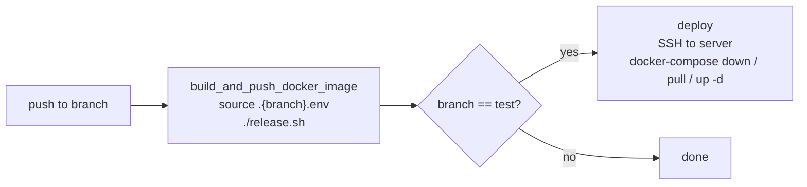

# Deployment

## Environments and branches

| Branch | Environment | Compose file | Env file | Deployed by CI? |
|---|---|---|---|---|
| `dev` | Development | `server-docker-compose-dev.yml` | `.env` | No |
| `test` | Test (`test.hararechristianfellowship.org`) | `server-docker-compose-test.yml` | `.test.env` | Intended (pipeline currently disabled) |
| `prod` *(not yet created)* | Production | *(not yet created)* | `.prod.env` (empty) | Not yet |

The pipeline picks files by branch name: `server-docker-compose-${CI_COMMIT_REF_NAME}.yml` and `.${CI_COMMIT_REF_NAME}.env`.
A new environment therefore needs **both** files named after its branch.

## Docker image

`Dockerfile`:

- Base `node:20-bookworm-slim` + FFmpeg from Debian apt.
- Copies `package*.json`, runs `npm install`, then copies **only `hcf-media-svr-test.js`**.
  Any new source file must be added to the `COPY` line or it will be missing from the image.
- Creates `/usr/src/app/media`; exposes `1935` and `8000`; runs `node hcf-media-svr-test.js`.

Build locally:

```bash
./build.sh           # docker build -t hcf-app .
```

## Single host (dev / test)

`server-docker-compose-{dev,test}.yml` (currently identical):

| Setting | Value | Notes |
|---|---|---|
| `network_mode` | `host` | Container shares the host network. The `ports:` list is ignored in this mode. |
| `user` | `${UID:-1000}:${GID:-1000}` | Files in `./media` are owned by the host user |
| `volumes` | `./media:/usr/src/app/media` | HLS + recordings persist on the host |
| `extra_hosts` | `host.docker.internal:host-gateway` | Lets the container reach the backend on the host |
| `API_BASE_URL` | `http://host.docker.internal:7002` | Backend API on the same machine |
| `restart` | `unless-stopped` | |
| `healthcheck` | `curl http://localhost:8001/` | **Not working**: wrong port and `curl` is not in the image ([KNOWN_ISSUES #10](KNOWN_ISSUES.md#10-container-healthcheck-can-never-pass)) |

```bash
docker compose -f server-docker-compose-test.yml up -d --build
docker compose -f server-docker-compose-test.yml logs -f
```

On the server the compose files live at `/home/ubuntu/data/` (see the deploy job below).

## TLS / HTTPS

`hcf-media-svr-test.js` reads Let's Encrypt certificates directly:

```
/etc/letsencrypt/live/test.hararechristianfellowship.org/privkey.pem
/etc/letsencrypt/live/test.hararechristianfellowship.org/fullchain.pem
```

and serves HTTPS on `8443`. The compose files do **not** mount `/etc/letsencrypt` into the container,
so this path does not exist inside it. See [KNOWN_ISSUES #1](KNOWN_ISSUES.md#1-production-entrypoint-crashes-on-startup)
and the proposal to terminate TLS at a reverse proxy instead ([ADR-0004](adr/0004-tls-at-reverse-proxy.md)).

## Docker Swarm (experimental)

`docker-compose-swarm.yml` sketches horizontal scaling: 2 replicas, 2 CPU / 2 GB limit each, restart on failure.
It is **not production-ready**:

- **Shared storage:** each replica writes HLS to its own local `./media`, but port 8000 uses Swarm's ingress
  load balancer, so a viewer can be routed to a replica that doesn't have the stream's files. A shared volume
  (NFS / EFS) or a single "origin" node is needed (noted in the file itself).
- **RTMP routing:** port 1935 is published in `host` mode, so only one replica per node can bind it,
  and the encoder must connect to the node actually running that replica.
- **Image:** `image: hcf-server-hcf-live-media-svr:latest` is a local name; worker nodes need a registry image.

Live video ingest is stateful (one publisher → one FFmpeg set), so scaling is usually done by
**scaling delivery** (CDN / caching proxy in front of port 8000) rather than replicating the ingest server.

## CI/CD

> **Current state: disabled.** Every line of `.gitlab-ci.yml` is commented out.
> **Open question:** the repository is hosted on **GitHub** (`hararefellowship/media-server`). GitLab CI only runs
> if the repo is mirrored to GitLab. Otherwise the pipeline needs to move to GitHub Actions.

### Intended pipeline (from `.gitlab-ci.yml`)



1. **Build:** source `.<branch>.env`, run `release.sh` (build, tag `<org>/hcf-app:<branch>`, push to Docker Hub).
2. **Deploy** (only on `test`): SSH as `ubuntu@<server>`, `docker system prune -f -a`, log in to Docker Hub,
   then `docker-compose -f /home/ubuntu/data/server-docker-compose-<branch>.yml down && pull && up -d`.

### CI variables expected

| Variable | Purpose |
|---|---|
| `DOCKER_ORGANIZATION_NAME` | Docker Hub org for the image tag |
| `DOCKER_USERNAME` / `DOCKER_PASSWORD` | Docker Hub login |
| `APP_SSH_PRIVATE_KEY_<branch>` | SSH key for the target server, per branch |
| `APP_PUBLIC_SERVER_IP_<branch>` | Target server IP, per branch |

### Gaps before it can run

- `release.sh` only runs `sudo docker-compose up --build` (the build/tag/push lines are commented out),
  and there is no `docker-compose.yml` in the repo for that command to find.
- The deploy pulls an image, but the compose files use `build: .` rather than `image: <org>/hcf-app:<branch>`.
- `docker login -p` puts the password on the command line; prefer `--password-stdin`.
- `StrictHostKeyChecking no` disables SSH host verification; prefer a pinned `known_hosts` entry.
- No lint or test stage yet.

These are tracked in [KNOWN_ISSUES](KNOWN_ISSUES.md#11-cicd-pipeline-is-not-runnable).

## Operations

| Task | How |
|---|---|
| Logs | `docker compose -f <file> logs -f`. FFmpeg output is very verbose (every stderr line is logged). |
| Disk | `./media` grows with every broadcast (full HLS history + full-quality MP4). Nothing cleans it up yet. |
| Restart | `docker compose -f <file> restart`. Live broadcasts drop; the encoder must reconnect. |
| Find a recording | `media/live/<streamKey>/<streamKey>.mp4` |
